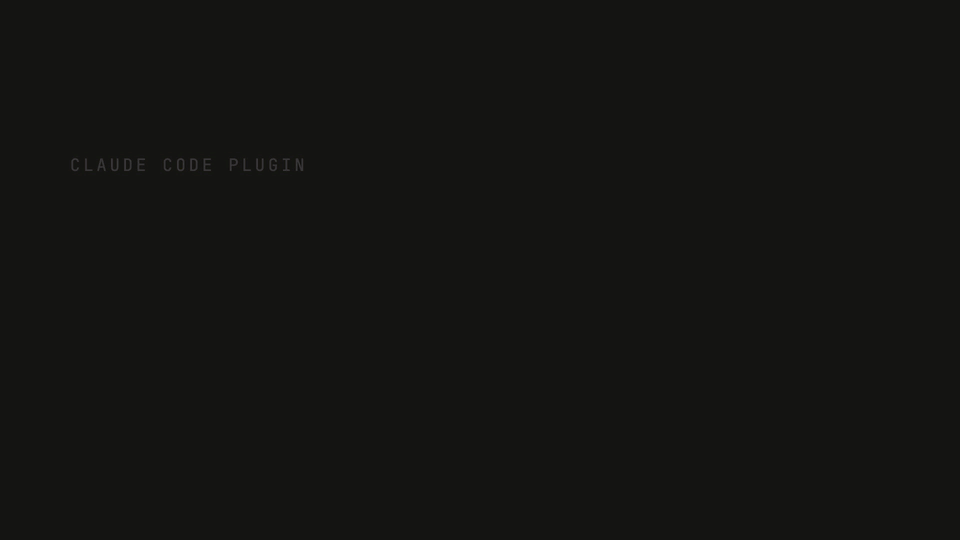

# cli-dispatch

> 🌐 **Languages:** **English** · [Türkçe](README.tr.md)

**Hand Claude Code's work to DeepSeek, Gemini (Antigravity), OpenAI Codex, OpenCode (OpenRouter), GitHub Copilot or a local Ollama model.** Claude Code's own subagents only run Anthropic models; cli-dispatch runs these six backends as workers from inside your `claude` session. A deterministic runner isolates each job in a git worktree, runs your verify command and returns a short verdict, so the worker does the work and Claude Code reviews it.



▶️ [Video](videos/demo-en.mp4) · 📝 [Write-up (Turkish, Medium)](https://medium.com/@rbinar/cli-dispatch-claudea-patron-deepseek-e-i%CC%87%C5%9F%C3%A7i-rol%C3%BC-veren-bir-plugin-b232803581fc)

## Install

Run these inside Claude Code (type `claude` first), one at a time:

```text
/plugin marketplace add rbinar/cli-dispatch
/plugin install cli-dispatch@cli-dispatch
/reload-plugins
/cli-dispatch:setup
```

Requires Claude Code 2.1.287 or newer. Setup asks which backends you want and installs their wrappers. Enter API keys with `/plugin configure cli-dispatch@cli-dispatch` (the dialog masks a key except its last 6 characters, so skip it during a screen share); models and backends go through `/cli-dispatch-config`. The local browser form is the fallback when the mod is not loaded. Keys never pass through Claude. Check the result with `/cli-dispatch:doctor`. Per-backend CLIs, sign-in and models: [Install](docs/install.md).

## Use

**Just ask.** Claude hands the job to the plugin's `dispatch` tool, which runs the worker in a git worktree, runs your verify command and returns the verdict and a patch for review (on Claude Code older than 2.1.287 the `cli-dispatch:runner` agent does the same):

```text
add() in math.mjs is broken. Delegate the fix to DeepSeek, verify with node --test.
```

▶️ End-to-end example ([mp4](videos/runs-monitor.mp4)): Claude hands a bug fix and a small CLI to Codex through the `dispatch` tool. You follow the worker's steps live in the run monitor and send it a message mid-run (`→ sent`, then `✉ delivered`); the worker picks it up, verify passes, and Claude applies the patch. Recorded live in a sandbox container.

https://github.com/user-attachments/assets/794e7173-baf4-483c-853f-88ecb8f7bc45

**Run it yourself.** No LLM tokens are spent on orchestration:

```text
/cli-dispatch:run cx "Fix add() in math.mjs" --verify 'node --test'
```

**Ask a one-shot question.** Read-only, with no repo changes:

```text
/cli-dispatch:ask ds "Explain what this regex matches: ^\d{3}-\d{4}$"
```

Backends: `ds` DeepSeek · `ag` Antigravity · `cx` Codex · `oc` OpenCode · `cp` Copilot · `ol` Ollama (local, Unix-only). The 12 commands are listed by `/cli-dispatch:help`; details are in [Commands](docs/commands.md).

> ⚠️ Workers can write files and run commands. Real repo work stays in a git worktree until you apply the patch ([Security and data](docs/security.md)).

## Watch a run

A band above the prompt lists this session's workers (`▶ cx 2m05s`, then `■ cx PASS`). Click one, or type `/cli-dispatch-runs`, to open the run monitor:

- **Flow:** the worker's steps as they happen, oldest first, in a frame that follows the run. The wheel or PageUp/PageDown scroll it; a click opens a step's full text.
- **Prompt** (`p`): the exact prompt the worker received, masked, scrollable in the same frame.
- **Info** (`i`): backend, repo, activity, events, tool calls and tokens on one line; `i` opens the full facts.
- **Message box:** `> message to worker...` sends the running worker a note. It shows in the Flow as `→ text  sent`, then `✉ text  delivered` once the worker reads it.
- **Questions:** a worker can ask you mid-run; the question opens as a dialog in Claude Code and your answer goes back to it.

Questions and messages work for runs started by the `dispatch` tool, on macOS, Linux and WSL. Details: [Commands](docs/commands.md).

▶️ A worker asks you mid-run ([mp4](videos/worker-question.mp4)): Codex needs a decision only you can make, so it asks; the question opens as a dialog in Claude Code, you answer, the same worker carries on and verify passes. Recorded live in a sandbox container.

https://github.com/user-attachments/assets/d3d047f6-2452-463b-bfd9-1c2081840502

## Update

```text
/plugin update cli-dispatch
/reload-plugins
/cli-dispatch:setup
```

Re-running setup refreshes the wrappers in `~/.local/bin`, which `/plugin update` does not touch.

## Documentation

[Install](docs/install.md) · [Commands](docs/commands.md) · [Deterministic runner](docs/runner.md) · [Sessions](docs/sessions.md) · [Policy injection](docs/policy-injection.md) · [Statusline](docs/statusline.md) · [Usage & quota](docs/quota.md) · [Features](docs/features.md) · [Internals](docs/internals.md) · [Windows](docs/windows.md) · [Security](docs/security.md) · [Uninstall](docs/uninstall.md) · [Terminal reference](TERMINAL.md) · [Changelog](CHANGELOG.md)

## License

MIT, see [LICENSE](LICENSE).
