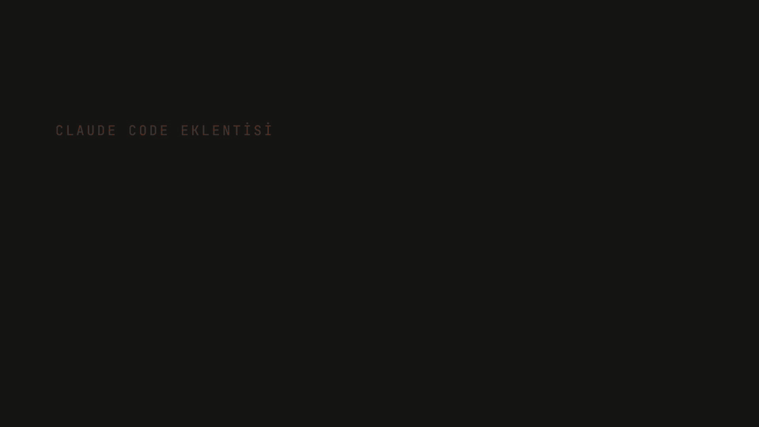

# cli-dispatch

> 🌐 **Diller:** [English](README.md) · **Türkçe**

**Claude Code'un işini DeepSeek, Gemini (Antigravity), OpenAI Codex, OpenCode (OpenRouter), GitHub Copilot ya da yerel bir Ollama modeline devret.** Claude Code'un kendi subagent'ları yalnız Anthropic modellerini çalıştırır; cli-dispatch bu altı backend'i `claude` oturumunun içinden worker olarak çalıştırır. Deterministik runner her işi bir git worktree'de izole eder, verify komutunu çalıştırır ve kısa bir sonuç döndürür: işi worker yapar, Claude Code gözden geçirir.



▶️ Video: [Türkçe](videos/demo-tr.mp4) · [English](videos/demo-en.mp4) · 📝 [Yazı (Medium)](https://medium.com/@rbinar/cli-dispatch-claudea-patron-deepseek-e-i%CC%87%C5%9F%C3%A7i-rol%C3%BC-veren-bir-plugin-b232803581fc)

## Kurulum

Bunları Claude Code içinde (önce `claude` yaz) sırayla, tek tek çalıştır:

```text
/plugin marketplace add rbinar/cli-dispatch
/plugin install cli-dispatch@cli-dispatch
/reload-plugins
/cli-dispatch:setup
```

Claude Code 2.1.287 veya daha yenisi gerekir. Setup hangi backend'leri istediğini sorar ve wrapper'larını kurar. API key'lerini `/plugin configure cli-dispatch@cli-dispatch` ile gir (diyalog key'i son 6 karakter hariç maskeler, o yüzden ekran paylaşırken girme); model ve backend ayarları `/cli-dispatch-config` üzerinden yapılır. Mod yüklü değilse yerel tarayıcı formu yedek yoldur. Key'ler Claude'dan hiç geçmez. Sonucu `/cli-dispatch:doctor` ile kontrol et. Backend başına CLI, giriş ve model ayrıntıları: [Kurulum](docs/tr/install.md).

## Kullanım

**Sadece iste.** Claude işi plugin'in `dispatch` aracına verir; araç worker'ı bir git worktree'de çalıştırır, verify komutunu çalıştırır ve sonucu, incelemen için bir yamayla birlikte döndürür (2.1.287'den eski Claude Code'da aynı işi `cli-dispatch:runner` agent'ı yapar):

```text
add() in math.mjs is broken. Delegate the fix to DeepSeek, verify with node --test.
```

▶️ Uçtan uca örnek ([mp4](videos/runs-monitor.mp4)): Claude bir hata düzeltmesini ve küçük bir CLI'ı `dispatch` aracıyla Codex'e devreder. Worker'ın adımlarını run monitor'de canlı izler, çalışırken ona bir mesaj gönderirsin (`→ sent`, sonra `✉ delivered`); worker mesajı alır, verify geçer, Claude da yamayı uygular. Bir sandbox container'ında canlı kaydedildi.

**Kendin çalıştır.** Orkestrasyona LLM token'ı harcanmaz:

```text
/cli-dispatch:run cx "Fix add() in math.mjs" --verify 'node --test'
```

**Tek seferlik soru sor.** Salt-okunur, repo değişmez:

```text
/cli-dispatch:ask ds "Explain what this regex matches: ^\d{3}-\d{4}$"
```

Backend'ler: `ds` DeepSeek · `ag` Antigravity · `cx` Codex · `oc` OpenCode · `cp` Copilot · `ol` Ollama (yerel, yalnız Unix). 12 komutun listesi `/cli-dispatch:help`'te, ayrıntılar [Komutlar](docs/tr/commands.md)'da.

> ⚠️ Worker'lar dosya yazabilir ve komut çalıştırabilir. Gerçek repo işi, yamayı sen uygulayana kadar bir git worktree'de kalır ([Güvenlik ve veri](docs/tr/security.md)).

## Run'ı izle

Prompt'un üstündeki şerit bu oturumun worker'larını gösterir (`▶ cx 2m05s`, sonra `■ cx PASS`). Birine tıkla ya da `/cli-dispatch-runs` yaz; run monitor açılır:

- **Flow:** worker'ın adımları oldukları anda, eskiden yeniye, run'ı takip eden bir çerçevede. Tekerlek ya da PageUp/PageDown kaydırır; bir adıma tıklamak tam metnini açar.
- **Prompt** (`p`): worker'a giden prompt'un birebir hali, maskeli, aynı çerçevede kaydırılabilir.
- **Info** (`i`): backend, repo, etkinlik, olay, araç çağrısı ve token tek satırda; `i` tüm ayrıntıları açar.
- **Mesaj kutusu:** `> message to worker...` çalışan worker'a not gönderir. Flow'da önce `→ metin  sent`, worker okuyunca `✉ metin  delivered` olarak görünür.
- **Sorular:** worker çalışırken sana soru sorabilir; soru Claude Code'da bir diyalog olarak açılır, cevabın worker'a geri gider.

Sorular ve mesajlar `dispatch` aracıyla başlatılan run'larda, macOS, Linux ve WSL'de çalışır. Ayrıntılar: [Komutlar](docs/tr/commands.md).

## Güncelleme

```text
/plugin update cli-dispatch
/reload-plugins
/cli-dispatch:setup
```

Setup'ı yeniden çalıştırmak `~/.local/bin`'deki wrapper'ları tazeler; `/plugin update` onlara dokunmaz.

## Dokümantasyon

[Kurulum](docs/tr/install.md) · [Komutlar](docs/tr/commands.md) · [Deterministik runner](docs/tr/runner.md) · [Oturumlar](docs/tr/sessions.md) · [Politika enjeksiyonu](docs/tr/policy-injection.md) · [Statusline](docs/tr/statusline.md) · [Kullanım ve kota](docs/tr/quota.md) · [Özellikler](docs/tr/features.md) · [İç yapı](docs/tr/internals.md) · [Windows](docs/tr/windows.md) · [Güvenlik](docs/tr/security.md) · [Kaldırma](docs/tr/uninstall.md) · [Terminal referansı](TERMINAL.md) · [Değişiklik günlüğü](CHANGELOG.md)

## Lisans

MIT, bkz. [LICENSE](LICENSE).
